# IFW Proof — Headless iOS Build Pipeline from Windows

[](https://github.com/origguard/ifw-proof/actions/workflows/ifw-ios-build.yml)
[](https://opensource.org/licenses/MIT)
[](https://developer.apple.com/documentation/apple-silicon)
[-black.svg)](https://github.com/actions/runner-images)

Minimal reproducible testbed proving that native **iOS ARM64 Mach-O binaries** can be configured from a **pure Windows workstation**, compiled in a headless macOS Apple Silicon cloud runner, and verified locally without ever opening Xcode or viewing a macOS desktop.

Part of the **OrigGuard IFW (iOS For Windows)** sovereign toolchain suite.

---

## 🎯 Architecture & Objectives

The goal of this repository is to validate **Étape 0a** of the IFW pipeline:

```mermaid
flowchart LR
    WIN["Windows 10/11 Workstation<br/>(Git + Node.js)"] -->|git push| GH["GitHub Actions<br/>(macos-14 Apple Silicon M2)"]
    GH -->|1. npm ci & cap sync| SYNC["Capacitor iOS Target"]
    SYNC -->|2. plutil -lint| LINT["Privacy Manifest Linter"]
    LINT -->|3. pod install| PODS["CocoaPods Dependency Engine"]
    PODS -->|4. xcodebuild| COMP["Mach-O ARM64 Compiler"]
    COMP -->|5. package unsigned| IPA["IFW-Proof-unsigned.ipa"]
    IPA -->|Artifact Download| VERIF["Windows Local Verification<br/>(cffaedfe magic & ARM64 check)"]
```



### Verified Properties
- **Zero Proprietary Code Exfiltration:** Only standard open Capacitor templates and public metadata.
- **Strict Clean-Room Manifests:** Apple 2024/2026 App Store compliance via `PrivacyInfo.xcprivacy` with standard API usage declarations (`CA92.1` for `NSPrivacyAccessedAPITypeUserDefaults`).
- **Reproducible Headless Compilation:** Automated `xcodebuild` targeting `generic/platform=iOS` in unsigned test mode (`CODE_SIGNING_ALLOWED=NO`).
- **Deterministic Artifact Packaging:** Production of an unsigned `.ipa` payload containing thin 64-bit Little-Endian ARM64 executables.

---

## 📦 Project Structure

```text
ifw-proof/
├── .github/
│   └── workflows/
│       └── ifw-ios-build.yml       # Headless macOS runner build orchestration
├── ios/
│   └── App/
│       ├── App/
│       │   ├── Info.plist          # Standard iOS bundle manifest
│       │   ├── PrivacyInfo.xcprivacy # Apple Privacy Manifest (mandatory 2024+)
│       │   └── AppDelegate.swift   # Minimal application lifecycle entry point
│       ├── App.xcodeproj/          # Native Xcode project structure
│       └── Podfile                 # CocoaPods resolution specifications
├── www/
│   └── index.html                  # Minimal HTML5 application payload
├── .gitignore                      # Hardened exclusions (Pods, xcuserdata, build artifacts)
├── capacitor.config.json           # Application descriptor (com.ifw.proof)
├── LICENSE                         # MIT License
└── package.json                    # @capacitor/core, @capacitor/cli, @capacitor/ios
```

---

## 🔬 Silicon Proof: Mach-O Binary Verification

To verify the compiled binary downloaded from GitHub Actions on your local Windows PC:

```powershell
# 1. Expand the downloaded IPA artifact
Copy-Item -LiteralPath ".\IFW-Proof-unsigned.ipa" -Destination ".\proof.zip" -Force
Expand-Archive -LiteralPath ".\proof.zip" -DestinationPath ".\ipa-check" -Force

# 2. Inspect Mach-O Magic Header and Target Architecture
node -e "
const fs = require('fs');
const buf = fs.readFileSync('ipa-check/Payload/App.app/App');
const magic = buf.subarray(0, 4).toString('hex');
const cputype = buf.readInt32LE(4);
console.log({
  path: 'Payload/App.app/App',
  sizeBytes: buf.length,
  magicHex: magic,
  cpuTypeHex: '0x' + cputype.toString(16)
});
console.log(magic === 'cffaedfe' ? '✔ OK: Mach-O 64-bit Little-Endian' : '✘ FAIL');
console.log(cputype === 0x0100000c ? '✔ CPU: Genuine ARM64 (Apple Silicon)' : '✘ FAIL');
"
```

### Expected Output
```text
{
  path: 'Payload/App.app/App',
  sizeBytes: 111504,
  magicHex: 'cffaedfe',
  cpuTypeHex: '0x100000c'
}
✔ OK: Mach-O 64-bit Little-Endian
✔ CPU: Genuine ARM64 (Apple Silicon)
```

---

## 🛡️ License

This project is licensed under the **MIT License** — see the [LICENSE](LICENSE) file for details.
